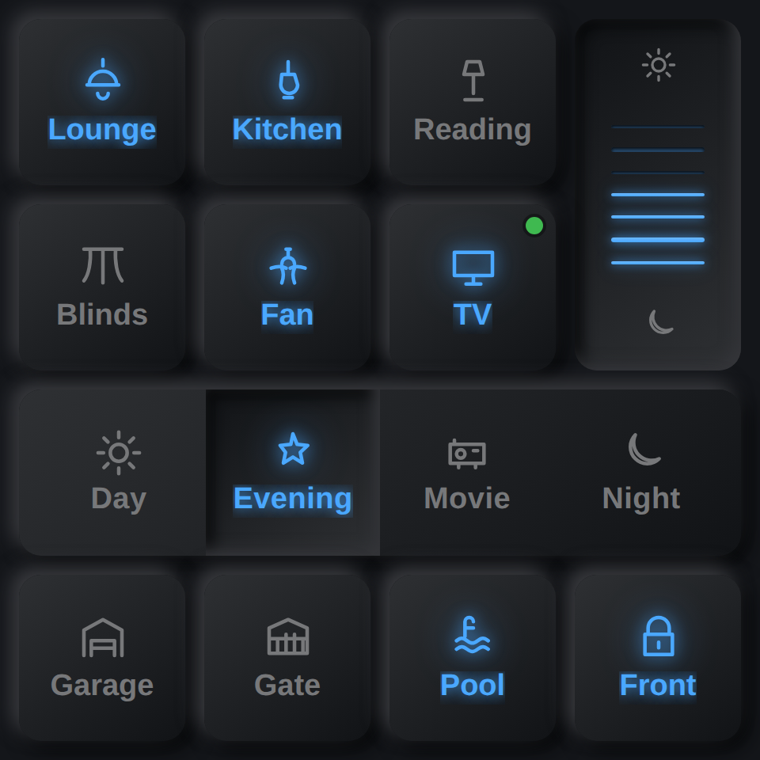
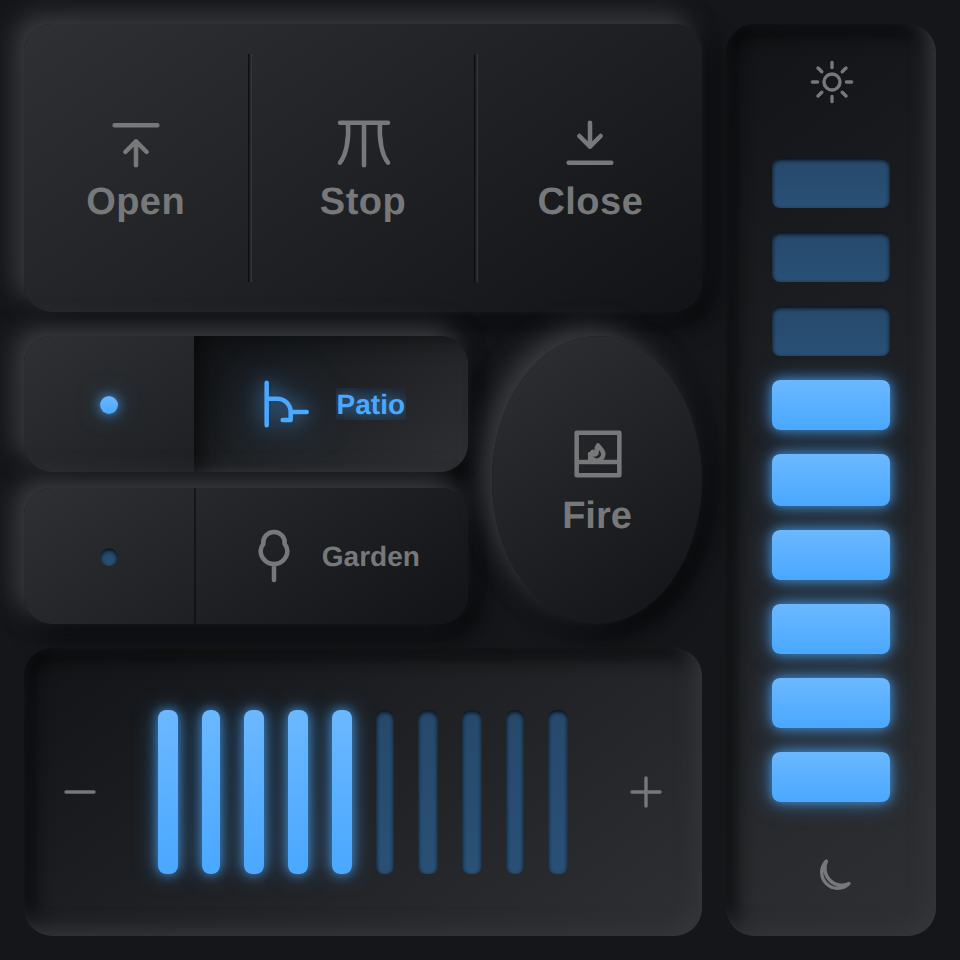
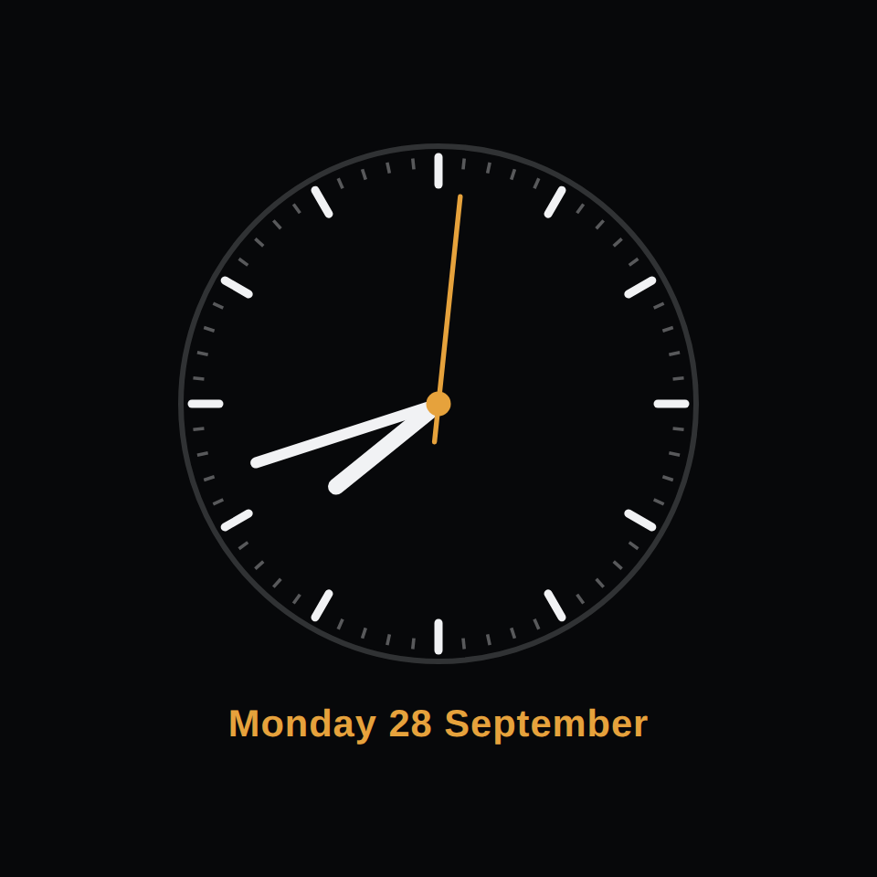
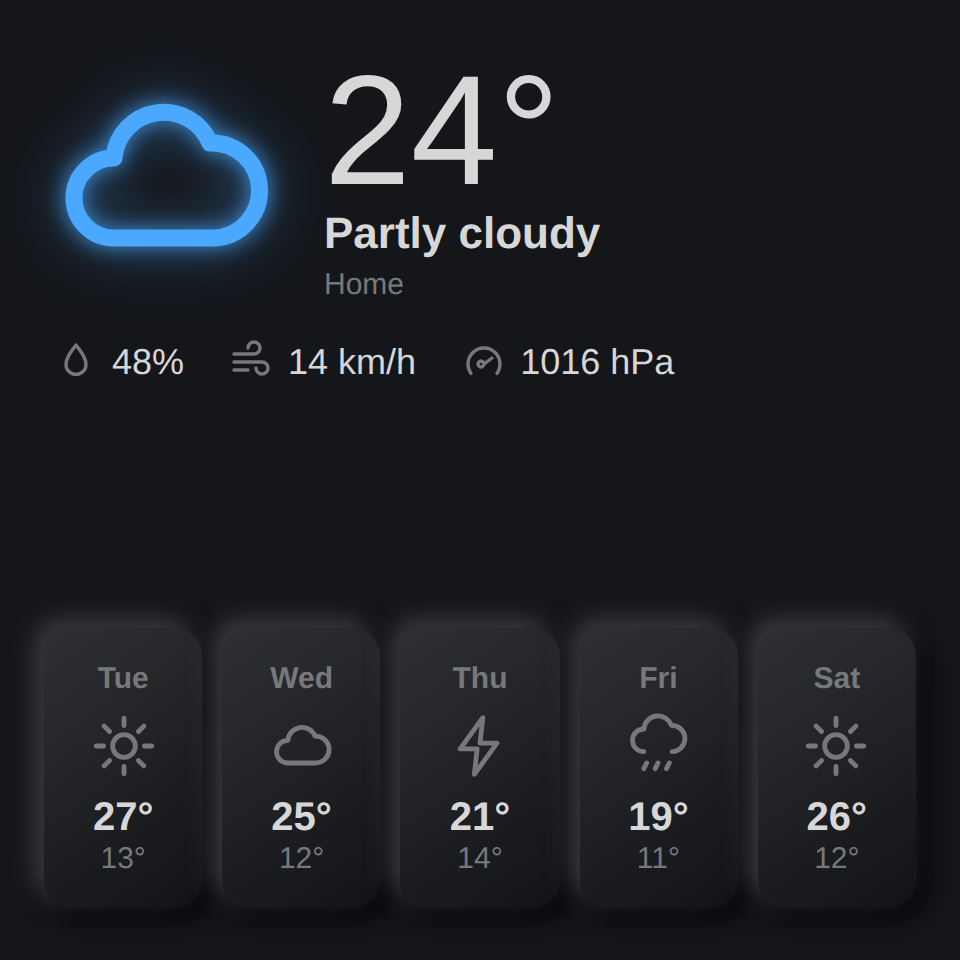
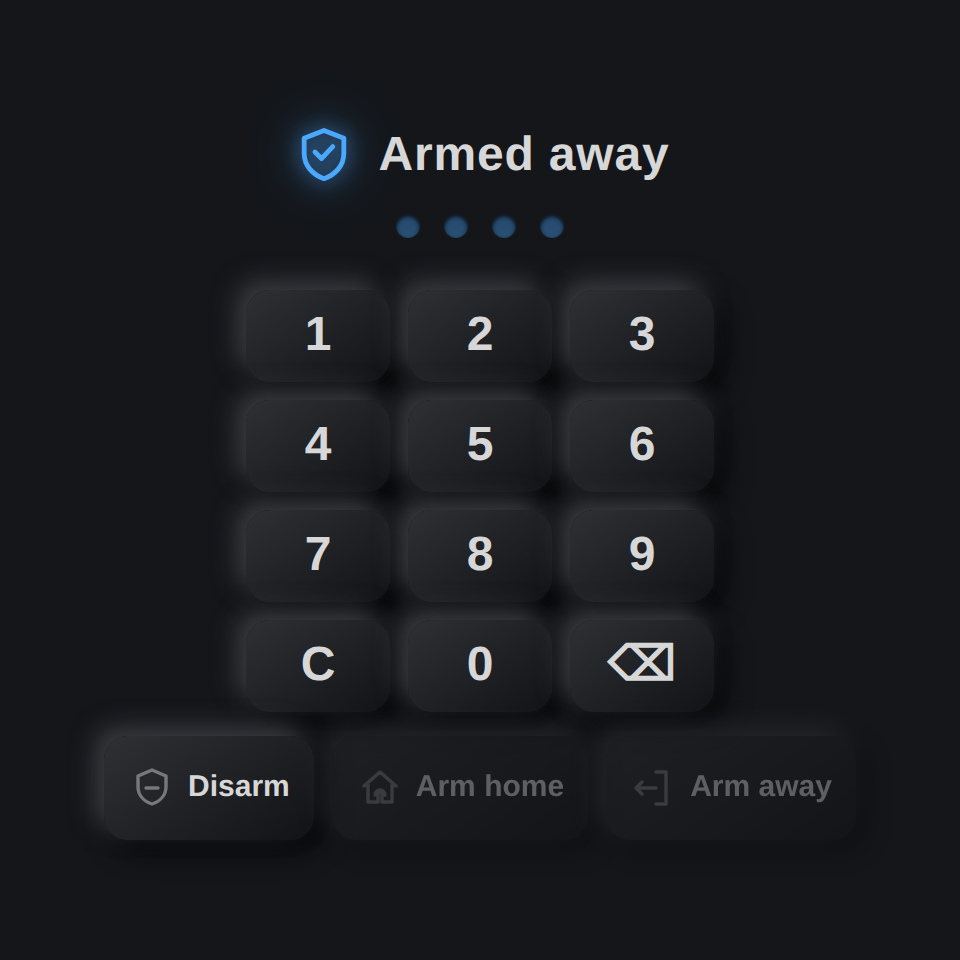
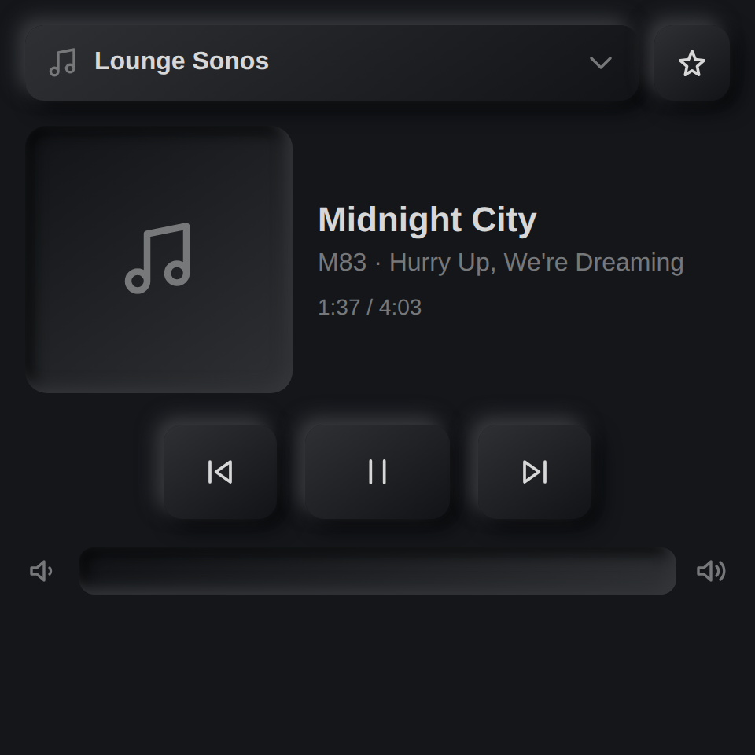
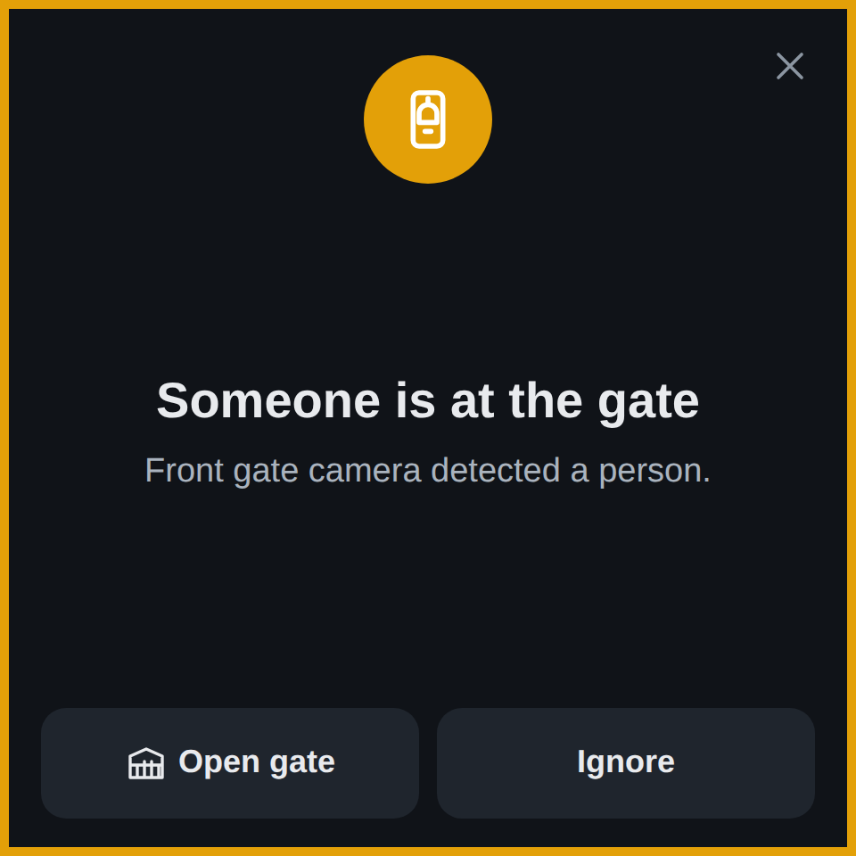
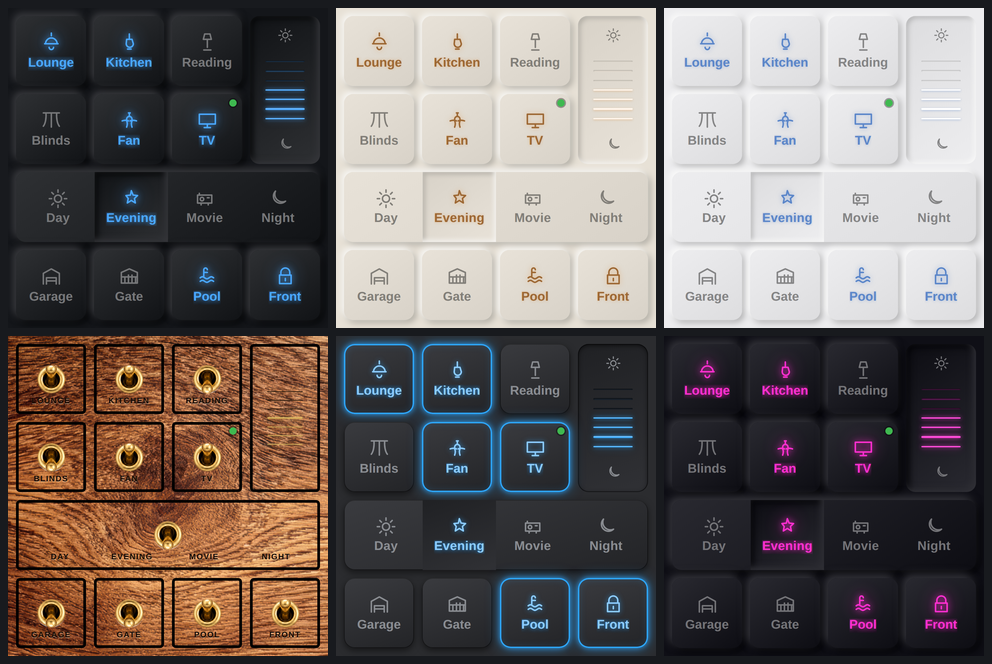
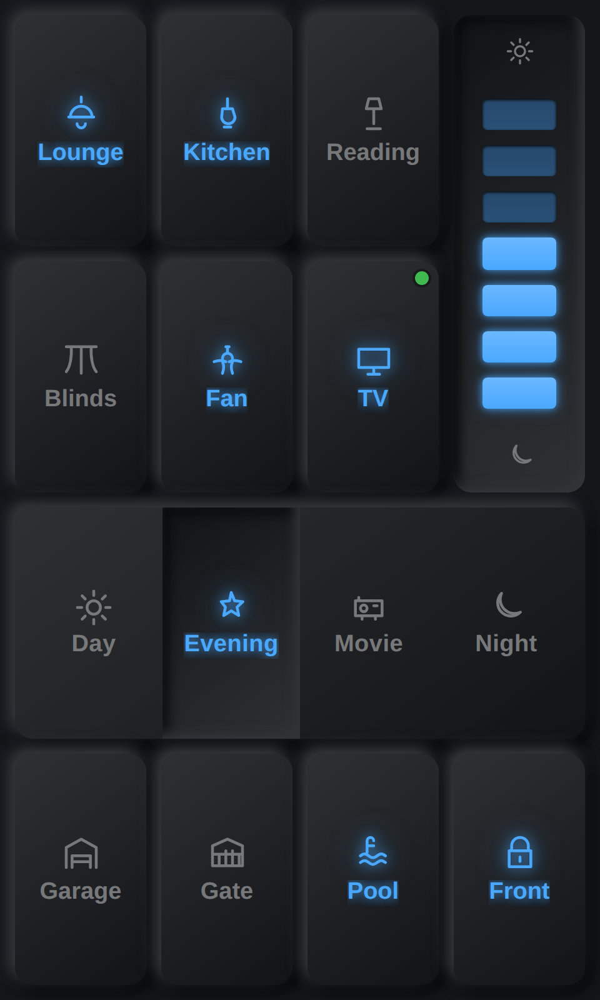

# AR NSPanel Pro

A Home Assistant integration **and panel app** for the Sonoff NSPanel Pro, by
[AR Smart Home](https://arsmarthome.co.za). You lay out pages of buttons, dimmers, switchers,
split buttons, rockers, a clock, weather, cameras, music and an alarm keypad in the Home
Assistant sidebar. The panel shows them and talks to Home Assistant over MQTT.

## Screenshots

<table>
  <tr>
    <td align="center"><br><sub><b>Grid</b>: buttons, dimmer, switcher, status dot</sub></td>
    <td align="center"><br><sub><b>Grid</b>: split, rocker, round button, dimmers</sub></td>
    <td align="center"><br><sub><b>Clock</b>: also the screensaver</sub></td>
  </tr>
  <tr>
    <td align="center"><br><sub><b>Weather</b>: now + 5-day forecast</sub></td>
    <td align="center"><br><sub><b>Alarm</b>: Alarmo keypad</sub></td>
    <td align="center"><br><sub><b>Music</b>: Music Assistant</sub></td>
  </tr>
  <tr>
    <td align="center"><br><sub><b>Notification</b> with action buttons</sub></td>
    <td align="center" colspan="2"><br><sub><b>Themes</b>: the same page in Tech Loft, Warm Minimal, Gallery White, Walnut Brass, Neon Pill and Cyberpunk (28 in the kit)</sub></td>
  </tr>
</table>

<p align="center"><br>
<sub>On a taller portrait panel the grid stretches to fill the screen.</sub></p>

## What's in the repo

| Path | What |
|---|---|
| `custom_components/ar_nspanel_pro/` | The Home Assistant integration: config flow, MQTT bridge, entities, services, the sidebar editor, and the built panel UI in `www/app/` |
| `panel/` | Source of the panel UI: plain JavaScript, no framework, one ~80 KB bundle. It renders with the same theme kit and icons as the editor's preview, so the glass matches what you designed |
| `android/` | The panel app: a Kotlin WebView kiosk around the panel UI. It adds the backlight, light and proximity sensors, screenshots, volume, boot-on-start and licence verification. No third-party libraries |
| `.github/workflows/panel-app.yml` | Builds the UI and the APK. A `v*` tag attaches the APK to the GitHub Release, where the sidebar's ADB Setup/Update tool picks it up |

## Install

1. **MQTT with WebSockets.** The panel connects to your broker over WebSockets. The Mosquitto
   add-on already listens for WebSockets on port **1884**. Home Assistant's MQTT integration must
   be set up.
2. **Integration (HACS).** HACS → ⋮ → Custom repositories → `https://github.com/marsh4200/ar_nspanel_pro`,
   category **Integration** → install **AR NSPanel Pro** → restart Home Assistant.
3. **Panel app.** Open **AR NSPanel Pro** in the sidebar → **Setup/Update**, enter the panel's IP
   (ADB over network must be enabled on the panel), tap *Allow USB debugging* on the panel, then
   **Install latest**. Optionally **Set as Home** so it replaces the stock launcher.
   (Or sideload: `adb install ar-nspanel-pro-X.Y.Z.apk`.)
   **USB-debugging-only panels (HDL S10 touch):** there is no network ADB, so do the first
   install over USB with [`tools/usb-setup`](tools/usb-setup/README.md) (Windows: double-click
   `install.bat`, or `takeover.bat` to replace HDL's screen). From then on the app updates over
   MQTT from Home Assistant (**Settings → Updates**), no cable needed.
4. **Panel setup screen** (opens on first start; later, press and hold the top-left corner for 3 s):
   - Broker: `ws://<home-assistant-ip>:1884`, plus MQTT username and password
   - Panel ID: e.g. `panel-kitchen`
   - Optional *Load UI from*: `http://<ha>:8123/ar_nspanel_pro_static/app/index.html`. The panel
     then takes UI updates straight from the integration, with no new APK needed. It falls back
     to the built-in copy when Home Assistant is down.
5. **Add the panel in Home Assistant.** Settings → Devices & Services → Add Integration →
   AR NSPanel Pro. A panel that is online is discovered automatically; otherwise enter the same
   Panel ID.
6. **Design** the pages in the sidebar editor and save. The panel redraws immediately.

The same UI also runs in any browser (for example
`http://<ha>:8123/ar_nspanel_pro_static/app/index.html`), which is handy for designing and
testing. In a browser, the backlight, sensors, screenshots and licence check aren't available.

## Page types

- **Grid**: button (toggle, push, or multi-state), dimmer, switcher, split, rocker, status dots, optimistic UI
- **Clock**: digital or analog, 12/24 h, localised date, alarm-clock indicator. Also used as the screensaver
- **Weather**: uses the first `weather.*` entity, or set `"weather": {"entity": "weather.home"}` on the page. Shows the current conditions and a 5-day forecast
- **Alarm**: Alarmo keypad over Alarmo's own MQTT topics. When the alarm is armed, the keypad becomes the screensaver; when it triggers, the siren sounds
- **Camera**: live MJPEG from Home Assistant with a PTZ D-pad and camera picker
- **Music**: Music Assistant players, now playing, transport, volume, and favourite radios/playlists

Also: notifications with action buttons (`ar_nspanel_pro.notify`, where `on_press` runs in
Home Assistant), a speaker entity for TTS and `media_player.play_media`, a siren entity, an
alarm clock, a screensaver with day/night auto-brightness, proximity wake, a motion sensor,
remote screenshots, and remote taps.

## Carousel taps right after a swipe (5.0.12)

- Residence 2 home screen and the Utilities 3D slider: a tap on an icon right after a swipe, while the icons are still gliding into place, was lost (the panel only got a click when the finger went down and up on the same spot), so it took a second tap or a wait. The tap is now taken from where the finger went down, as soon as it lifts.

## Utilities sections: your own icons, 4C-style switches (5.0.11)

- Device Setup > Whole house > Utilities: each section (Pool, Irrigation, Geysers, Other) has its own icon for the 3D slider: the 3D default, any library icon, or your own upload (background removed, shown as the icon only, no circle). Stored as `residence.icons.u_pool` / `u_irrigation` / `u_geyser` / `u_more`; uploads travel inside the setup like the other button icons.
- Inside a section the switches are 4C-style rows (picture, name, state, power button), on / off only; tap the row or the button. Full width and finger size on the S57, two a row on square and wide panels.

## Utilities in sections (5.0.10)

- Device Setup > Whole house > Utilities is now four sections: **Pool**, **Irrigation**, **Geysers** and **Other**. Add each switch to its section (adding it to another section moves it). The 3D slider shows one icon per section, whatever the switches are called. Stored as `elegant.utilGroups` (`{entity_id: "pool" | "irrigation" | "geyser"}`; not listed = Other); `elegant.utilities` stays the full list. Setups from before sections still sort by picture and name until a section is set.

## Utilities: 3D slider, and uploaded icons on the S57 (5.0.9)

- Residence Utilities page has a fifth design, **3D slider** (Device Setup > Utilities page, or the customer's Settings > Look > Designs): Pool, Irrigation and Geysers (and More, for anything else) as big 3D icons on a carousel that goes round and round. Tap the front one for its switches (picture tiles); Back returns to the icons. Devices go in the sections set in Device Setup (5.0.10). With only one group the switches show straight away. Works on every Residence panel: tall, square and wide.
- New 3D icons in the same chrome-and-glass style as Energy and Comfort: Pool, Water drop (irrigation) and Flame (geyser), also in the icon picker.
- Uploaded button icons now travel inside the setup sent to the panel (up to 200 KB each), so a panel running its built-in screen (the HDL S57) shows them without downloading them from Home Assistant.
- Residence 2 on tall screens: the Utilities picture tiles are two a row at finger size.

## Read from panel brings the customer's names (5.0.8)

- The panel now reports the names the customer gave on it (Residence Settings > Rooms: room names and light names), not just how many. Read from panel lists each one (panel name next to the setup name), ticked; "Copy ticked into this setup" puts them into the room names and `elegant.names`, so they survive a reset or a new panel after Save & Push. Panels on an older panel app still show the count only.

## Rename devices for the panel (5.0.7)

- Setup > Rooms (every section: lights, climate, speakers, TVs, shades, scenes, presence) and Whole house (cameras, alarm, utilities): ✎ or tap a name to give it the name the panel shows. "In Home Assistant: …" keeps the real name in view, and ↺ goes back to it. Home Assistant's own names are not touched.
- Stored as `elegant.names` (`{entity_id: name}`) and pushed with Save & Push. Home Assistant sends the new name in each device's state, so it shows on panels already installed; the panel also reads it from the setup (for scenes). A name the customer gives on the panel itself (Residence Settings > Rooms) still wins.

## Residence 2: big alarm code keypad (5.0.6)

- On tall portrait panels with Residence 2 on, the code keypad that opens from Security (Away / Home / Night / Disarm on an alarm with a code) is now full size: big keys and code dots on a solid backdrop. The keys were capped at the search keyboard's 58 px width. Other panels are unchanged.

## Residence 2: bigger everything on portrait screens (5.0.5)

- On tall portrait panels (HDL S57, portrait NSPanel Pro) with Residence 2 on, the top bar is two rows: clock, call, calendar and settings on top; a big back (or home) button and the page or room title underneath. Room Off, home and what's playing in the bottom bar are about twice the size.
- Every page stacks top to bottom for a portrait screen: Comfort (dial, then modes 3-wide), Listen, Watch, Shades, Cameras, Security (state, then modes 2 × 2) and Scenes (two a row), with finger-size buttons and readable text.
- Settings opens full screen with the tabs across the top, each label above its options, and big chips, sliders, icon picker, room list, rename keyboard, PIN pad and panel info.
- Square and landscape panels, plain Residence and every other panel model are unchanged.

## Residence 2 swipes smoothly on the HDL S57 (5.0.4)

- While a finger moves, Residence 2 now only moves icons that are already drawn, which is GPU work. Labels, halos and the background glow change once, when the swipe settles. In a 6× CPU-slowed test, the drawing work during one swipe dropped from 548 ms to 13 ms.
- On the HDL S57 (Mali-400 GPU) the icons don't float and have no reflection. `residence.v2Reflect: true` turns the reflection back on.

## HDL S57 WebView install fixes (5.0.3)

- `tools/s57-webview`: makes `/system` writable with `adb remount`, which the S57 accepts (its own `mount -o rw,remount` doesn't). It also sets `persist.sys.webview.vmsize` to 250 MB before the reboot: Android 6 keeps only 100 MB for the WebView library, never grows it by itself on the S57, and WebView 106's 64-bit library needs 120 MB.
- The script refuses a WebView that isn't named `com.android.webview`, such as Google's.

## HDL S57 without Chrome (5.0.2)

- The legacy APK now draws the panel screen in Android's own WebView whenever the panel's WebView is new enough (90 or later), the same way as the standard build. Older panels (the HDL S10 touch, WebView 39) keep using Chrome as before.
- `tools/s57-webview`: gives the HDL S57 WebView 106 (LineageOS's *Android System WebView 106.0.5249.126, arm64-v8a + arm-v7a*, from APKMirror, saved as `webview.apk`). It backs up the original first; `webview-restore.bat` puts the original back. After this, the S57 has no Chrome, no address bar, no switch to full screen and no white strip.
- Chrome fixes for panels that still use Chrome: the web-app manifest is back in `<head>` (Chrome hadn't been seeing it since 4.8.10), and a plain "Add to Home screen" bookmark is no longer mistaken for a full-screen web app.

## Residence 2 and the HDL S57 (5.0.1)

- **Residence 2** (Device Setup > Dashboard style), for the NSPanel Pro and the HDL S57 only: one big 3D icon per page, with no tile, swiped like a carousel. Its icons can be changed like Residence's, and it comes with a new set of 3D icons. Its Lights page defaults to *Minimal tall*: one full-width row per light, filled to its level in the light's own colour. The landscape panels (Source 7 / 10, TDX, Akubela) and the Samsung tablet always stay on plain Residence.
- **HDL S57** panel type in Device Setup: Android 6, with the screen running in Chrome. The first install goes over USB (`tools/usb-setup`, with `chrome106.apk` next to the scripts); after that, updates go over the air.
- The panel only shows the new screen after this app update, or when its *Load UI from* is set to Home Assistant.

## Renamed lights show up straight away (5.0.0)

Renaming a light (or a room) under Settings > Rooms on the panel saved the new name, but the Residence lights page kept drawing the old one until something else made it rebuild. It now redraws as soon as you rename. Panel screen only: no new APK.

## Boot firework no longer freezes (4.8.10)

On the panels the firework stopped dead halfway: the app started at the same moment, and starting it keeps the panel too busy to draw. The app is now downloaded during the firework but only started once the burst is over (by 3.6 s at the latest). The logo then holds while the home screen is built behind it, and the boot fades out about 6 s from the start (at least 2.5 s after the app starts). Still no skip. Panel screen only: no new APK.

## Boot firework (4.8.9)

The boot screen now opens with a small firework: a rocket climbs from the bottom and bursts into blue, ice-white and gold sparks, and the A&R Smart Home logo pops out of the burst. The logo then holds while the loading bar fills, and the panel fades into the app after about 5.8 s (was 8 s). A tap no longer skips it. It is drawn on one canvas in plain old JavaScript, so Android 5 panels run it too. Panel screen only: no new APK.

## Faster Icons and Backgrounds, icon categories (4.8.8)

- **Settings → Icons opens fast.** The built-in icons are drawings with blur and gradients, slow for a panel to draw, and Settings drew all 61 again on every tap. Each one is now drawn once, quietly, a few seconds after start-up, into a small picture that shows instantly.
- **Look → Backgrounds opens fast.** The tiles show small thumbnails (`www/residence/thumbs/`, 65 KB for all 32) instead of the full photos (1.5 MB). The full photo only loads when it is picked. Uploaded backgrounds get a small copy made once.
- **Icon categories.** A chip row (All, Lighting, Climate, Security, Media, Doors & shades, Utilities, Scenes & rooms) above the icons. It opens on the category that fits the button (Lights → Lighting, Comfort → Climate, Cameras and Security → Security, Listen and Watch → Media). As set up, Line and your uploaded icons are always in the first row. All shows every category under its own heading.

## Uploaded icons shown as icons (4.8.8)

An icon uploaded in AR Lighting Scenes now sits in the home button like the built-in icons (the button's ring and style stay), instead of filling the button like a photo. Settings → Icons shows it the same way. With AR Lighting Scenes 1.1.1 the background is removed on upload, so only the icon shows. Panel screen only: no new APK.

## Install the app from a file (4.8.7)

**Device Setup / Update** has an **Install from file** box under the App buttons. Drop an `.apk` on it (or click and choose one) and it installs exactly like **Install app**, only without GitHub: handy when GitHub is slow or you have a build that isn't released yet.

- The file goes to Home Assistant first, then the panel fetches it from Home Assistant (panels without curl get it sent over ADB).
- Same install as the button: `pm install`, check the app is on storage, `sync`, and on HDL panels Home is set and saved again. The Source 7 kiosk lock is applied as usual.
- Nothing else changes. **Use AR app (HDL off)** and **Back to HDL screen** are untouched, and HDL stays on or off as it was.
- Android 5/6 panels need the `-legacy-` APK; the log warns if the file looks like the wrong one.
- Only Home Assistant administrators can upload. The file is kept in memory for an hour, then dropped.

## Uploaded icons and backgrounds (4.8.6)

- New `set_media` service, used by **AR Lighting Scenes 1.1.0**: the icons and backgrounds the customer
  uploads there (up to 10 of each, cropped on their phone) go to every panel. On the panel, uploaded icons
  appear in Settings > Icons and uploaded backgrounds in Settings > Look > Backgrounds (an "Uploaded"
  group). An icon is only ever offered as an icon, a background only as a background. A deleted upload
  puts the panels using it back to their own.

## Home icons from the panel (4.8.5)

- New **Icons** tab in the panel's Settings (under Display): lists the buttons on the home screen; tap one
  to give it a different icon (As set up, the plain line icon, or any of the 61 picture icons).
  Saved with the customer's settings (so in the Customer settings backup); "Back to how it was set up"
  clears them. Home Assistant's Customer settings tab lists which buttons were changed.

## Smooth knob, tap to select fixed (4.8.4)

- Knob dimming is smooth: a slow turn moves half a step (2.5% with the default 5%), a normal turn one
  step, and only a sustained fast spin doubles it (never triples, as before from the first quick detent).
  While the knob turns, the level glides between detents on every Lights design. Volume follows the
  same idea (1 point per slow detent).
- Tap to select now works in every Residence Lights design: the first tap on a light that can be
  highlighted only highlights it (the knob then dims it); a tap on the highlighted light switches it.
  With "Dimmable lights only", on/off lights still switch on the first tap. Before, the first tap
  highlighted and switched at the same time. The 4C power button and the Keypad OFF / ON keys still act
  at once.
- Fixed: tapping the lamp of an on/off light in some designs switched it twice (so nothing happened).

## Lamps per room, highlight fixes (4.8.3)

- New **Lamps** tab on the panel (Settings > Look): per room, set every light's drawn colour
  (2700K / 3000K / 4000K / 5000K / 6500K) and lamp (Pendant, Filament, Downlight, Bulb / strip) in one tap,
  or open a light to give it its own. A light's own pick beats its room's; both beat Device Setup.
  Drawing only: lights that report their own colour to Home Assistant still show their real colour.
- Fixed: the lamp types picked per light in Device Setup were never applied (a name clash made the panel
  always guess from the light's name).
- Pills, Minimal and Keypad list: the selected light's highlight ring is no longer cut off at the top.
- Minimal: dimmable lights get a round dot at the end of their line.

## Panel designs, idle return and Restart panel (4.8.2)

- 4C style: the selected light's highlight ring is no longer clipped at the top and sides (Lights and Scenes tabs).
- Three new Lights page designs next to the existing ones: **Pills**, **Wall plates** and **Minimal**
  (Settings > Look > Designs on the panel, or Device Setup).
- Settings on the panel: Text size removed (every panel back to normal size); **Restart panel** under
  Panel: tap twice and Home Assistant restarts the panel over ADB (`sync; reboot`, ports 8555 then 5555;
  the ADB port is left alone). If HA can't reach it, the panel shows a message.
- Settings always closes after 20 seconds without a touch or knob turn. New **Back to the room**
  (Settings > Display, off by default): a page opened from a room goes back to that room's main screen
  after 20 seconds idle. Never during an intercom call.

## Customer settings backup + home auto-fit (4.8.1)

- **Customer settings** tab on each panel's device page in Home Assistant: shows what the customer
  changed with the panel's gear button, **Save backup** keeps it in Home Assistant, and **Restore to
  panel** sends it back (the panel reloads with it). Use it before an update or push, after a reset,
  or on a replacement panel. Restored design picks (Lights page, Utilities page, clock) win over the
  setup pushed since. Needs panel app 4.8.1+ (the panel now reports its full settings on `sys/prefs`).
- HDL panels (Source 7 / Source 10): ADB install/update and "Use AR app (HDL off)" now check the app is
  really on storage (`pm path`), run `sync`, make the AR app Home (`set-home-activity`, every install,
  since an update can clear the Home choice), check Home and `sync` again, so a reboot or a power cut
  opens the AR app. The log ends with "Home = AR app ✓ · saved ✓. Safe to reboot."
- Residence home screen stays a still screen: when the category buttons don't fit (many categories,
  or shorter screens like the Source 10 / Source 7), the grid picks the best column count and shrinks
  just enough to fit, instead of pushing a row off the bottom.

## All-round performance pass (4.7.9)

Measured on the whole panel app with a busy house (a light dimming and a sensor changing 4 times a
second), CPU slowed 6x to match the Source 10:
- Every Home Assistant update used to rebuild the page on screen, even when it showed nothing that
  changed. The panel now notes which states each page shows and only redraws when one of those
  changes; a burst of updates is drawn once, before the next frame. Comfort / Listen / Watch /
  Shades / Cameras / Scenes went from ~100-170 ms of work per second to ~15-20 ms.
- The top bar (clock, weather, alarm, calendar, now playing) rewrote itself on every update; it now
  only writes what really changed (DOM churn from ~30 nodes/s to ~1).
- Checked: no running animations at idle, no memory / listener / timer build-up after 30 rounds of
  opening every page and the settings.

Setup: two new buttons for HDL panels (Source 10 / Source 7):
- **AR app as Home screen** makes the AR app the Home screen (opens on boot and on Home) and leaves
  HDL on, unlike "Use AR app (HDL off)".
- **HDL as Home screen** makes HDL's screen the Home screen again; nothing is switched on or off and
  the AR app stays installed. (If HDL was switched off with "Use AR app", use "Back to HDL screen".)
- **Boot check** (reads only): right after a reboot, shows whether the AR app is still installed,
  who is Home, which HDL apps run and may remove apps, and this boot's log about it — to find what
  removes the app on reboot. "AR app as Home screen" also reports when HDL takes Home back.
No APK needed.

## No lag after leaving the cameras page (4.7.8)

Leaving the cameras page released the RTSP players at once, and Android does that on the thread
that handles touches and draws the screen; on Rockchip the hardware decoder can take a few hundred
milliseconds to shut down, so the next tap (e.g. Lights) sometimes lagged. The tile now disappears
at once, stop() frees the decoder on the player's own thread, and the rest is released 1.5 s later.
Needs the 4.7.8 APK.

## Speed readout (4.7.7)

Settings (gear) > Panel shows what the panel last measured: wake-up (touch to screen ready),
the last page opened (time to draw it), and the last light switched or dimmed (time until Home
Assistant reported the change). The same lines go to the console as "[speed] …". Panel UI only.

## Camera page: settings on top, double tap, swipe (4.7.6)

- The gear's Settings window now hides live RTSP video while it is open (the app draws that video
  above the page), and nothing brings it back until Settings closes.
- A tap opens a camera full size; there a double tap goes back to all cameras (a single tap no
  longer flips straight back), and a swipe left / right goes to the next / previous camera.
- Stepping to another camera keeps the current picture until the next one has its first frame
  (up to 4 s), instead of a black "Connecting…" box. Gestures and the hand-over need the 4.7.6 APK;
  with an older app two quick taps still count as a double tap.

## Camera decoder choice per panel (4.7.5)

Some panels' default H.265 hardware decoder (HDL Source 10, RK3568) keeps showing green / stale
pictures on a stream other panels play cleanly. Settings (gear) > Panel > Camera decoder picks
Auto, Other hardware or Software for RTSP cameras on that panel; it is kept on the panel and the
cameras restart with it straight away. The player log (ADB > Check camera) now lists the
decoders and names the one playing, and reports frames a slow decoder drops. Needs the 4.7.5 APK.
Also: the vendored RTSP module's androidx.annotation dependency (the 4.7.4 build fix), and the
release-lookup error now says why GitHub refused (token expired / no permission / no release).

## H.265 RTSP cameras: green flashes fixed at the source (4.7.4)

Found with the panel's player log: Media3's H.265 RTSP reader (1.5.1, still in 1.11.1) dropped the
video packet numbered 65535 every time the camera's 16-bit RTP counter rolled over (every ~90 s
on a 4 MP camera), so a picture broke and the panel showed green / stale frames until the next
keyframe. The app now carries Media3's RTSP module with that one line fixed
(android/app/src/main/java/androidx/media3/exoplayer/rtsp, see README-AR.md there). H.264 cameras
were never affected. The 4.7.3 SurfaceView change is undone (camera name and rounded corners are
back). Check camera now also reports packets the player dropped. Needs the 4.7.4 APK.

## RTSP video surface for Android 11+ panels (4.7.3)

On RK3566 / RK3568 panels (Android 11 and newer) RTSP cameras kept flashing green and showing
stale frames although the player itself ran without a break (one start per opening, no errors in
the player log). The video was drawn into a TextureView, whose GPU copy of the hardware decoder's
pictures misbehaves there; those panels now draw into a SurfaceView, Android's own video surface.
Older panels (px30, Android 8.1) are unchanged. Needs the 4.7.3 APK. The ADB tools' Check camera
now tests the panel's own RTSP camera without asking for its address (it asks when there are
several).

## Cameras stop restarting (4.7.2)

With one camera opened full size from the camera grid, every Home Assistant update (several a
second in a busy house) rebuilt the cameras page and restarted the stream: the picture kept
flashing green and the camera's clock jumped back and forth between the live snapshot and a
freshly started stream. The page now only checks the camera that is on screen.

## RTSP cameras without the green start (4.7.1)

RTSP cameras played by the panel app no longer flash green when they open or when you step to the
next camera. A stream is joined part-way through the camera's picture group, and Rockchip panels'
hardware decoders turned the frames before the next keyframe into green pictures; the decoder is
now fed nothing until the first keyframe, so the first picture shown is a whole one ("Connecting…"
stays until then). Needs the 4.7.1 APK.

## Customer settings, boot logo, camera and highlight fixes (4.7.0)

New on the panel's gear (Residence):
- **Rooms** tab: put rooms in the customer's order, hide rooms they don't use, rename rooms and
  lights (an on-screen keyboard, as kiosk panels may have none). Display only: Home Assistant and
  every room action keep the set-up rooms and names.
- **Display**: Text size (Normal / Large / Extra large), Clean screen (touch off for 30 s; it was
  behind the installer PIN before) and Tap to select (Highlight / Dimmable lights only / Off).
- **Look > Backgrounds**: a picture for every room, or for one room only.
- **Clock & room**: Sounds volume (doorbell, intercom and message chimes) and Do not disturb hours
  (those chimes stay quiet; alarms and sirens always sound).
- **Boot logo**: the A&R Smart Home Automation logo for about 8 s when the app starts (tap to skip).
- **Tap to select** now shows its highlight ring on every Residence Lights layout (Faders, Bubble
  tiles, Bubbles, Keypad list, Gallery, 4C style), not only the Dial list.
- **Cameras**: no more green frames when a camera opens or you step to the next one. Live HLS starts
  on a whole segment (always a keyframe) and only fades in once real pictures decode, the snapshot
  staying until then; native RTSP video stays hidden until its first frame and isn't re-laid out on
  every update (the RTSP part needs the new APK).
- Read from panel lists all of these; Tap to select can be copied into the setup.

## Watch sources fit the screen, ADB remote (4.6.5)

The Watch page lays its sources out in even rows that always fit (4 in a row, 3 + 2, 3 + 3, 6 + 6 …),
shrinking as more are added; they no longer vanish on older panels once a fourth wraps to a new row.
The remote's arrows and OK now also work with an **ADB** Android box (the Android Debug Bridge
integration's media player, keys sent as Android key codes), and a remote from Android TV Remote,
Apple TV or Roku always gets its own key names, even if the type in the editor was left on Apple TV.

## Read from panel (4.6.4)

The panel now reports what the customer changed with the gear button (background, theme colour,
button look, Lights / Utilities / Clock designs, screensaver, 12/24 hour, date language, plus
night mode, brightness, home room and tap sounds). In Device Setup > Residence look, **Read from
panel** lists each one next to your setup; tick what to keep, **Copy ticked into this setup**, then
Save & Push. Copied settings survive a reset or a new panel. Night mode, brightness, home room and
tap sounds have no installer setting: they stay on the panel and a push never changes them. The
installer's Glow when on now offers the same 17 colours as the panel's Themes tab.

## Themes and a smoother Blue sky clock (4.6.3)

Settings > Look has a new **Themes** tab: 17 highlight colours (Warm, Cool, Vivid, Neutral) for lit
buttons, badges, tabs, chips and switches, or "As set up" for the installer's choice. Lamps keep
their own light colour (2700K, 6000K, …); on the Lights page the glow under each lamp now matches
that light too. The old Glow row moved here. The **Blue sky** clock screen no longer freezes weak
panels: the clouds are ready-made pictures that only slide, and the time-of-day tint is baked in
once instead of filtered every frame.

## 4C style Lights and Utilities designs (4.6.2)

Lights page layout **4C style**: Lights / Scenes at the top, a row per light (its lamp, name,
level, a long slider, a power button), and This room / All rooms / Only on / All off at the
bottom. **Utilities page** designs: Classic (the picture tiles), Living list (slim rows, the
devices move while running), Flow (water and power lines with each device on them, flowing while
something runs) and Switch plate (a wall plate of brass rocker switches). Both are picked in Device
Setup > Residence look > More options, or on the panel in Settings > Look > Designs.

## Light colours (4.6.1)

Residence draws each lamp in the light's own colour: a light that reports its colour temperature or
RGB colour to Home Assistant is drawn in that colour, and dimming only makes it weaker, it doesn't
turn it yellow. For plain dimmers pick the white in Device Setup > Residence look > More options >
Light colour (Warm 2700K, Soft 3000K, Neutral 4000K, Cool 5000K, Daylight 6500K, or Dim to warm),
for all lights or per light (also in Easy setup, next to each light).

## Residence designs, clock screens and easy setup (4.6.0)

**Lights page layouts.** Seven, all but Classic drawing each lamp shining and dimming:
Classic (the old light cards), Faders, Bubble tiles, Bubbles, Keypad list (Control4 style rows
with OFF / ON), Dial and Gallery. Moods (the customer's scenes, All on, All off) beside them.

**Clock screens.** What a Residence panel shows while it sleeps: Classic (the plain clock),
Signature glow, Sun path, Halo, Moonlight, Editorial, Living photo, Flip clock and Blue sky (real
looking clouds, the sky colour follows the day). Sunrise / sunset and the moon are worked out on the
panel from the home's rough location, which Home Assistant now sends (2 decimals). The clock moves a
few pixels every 20 s so nothing burns in.

**Where to pick.** Installer: Device Setup > Residence look > More options > Lights page > Layout,
and Clock screen. Customer: Settings > Look > Designs on the panel (Backgrounds keeps the photos,
glow and buttons). The newest choice wins: a customer's pick stays until the installer pushes a
different one.

**Easy setup.** Device > Dashboard now opens in steps (Style, Rooms, Whole house, Look, Check &
push). Rooms: pick a room, tap + on what's in it, pick devices by their names with the ones in that
Home Assistant area first, set each light's lamp drawing right there, and see the room's buttons in
a small panel preview. *Import areas* builds the rooms from Home Assistant's areas in one go
(devices already in a room stay put). *All settings (one page)* is the old long page.

## Residence Lights: lamps that shine (4.5.1)

Residence's Lights page is one tall glass fader per light. Its lamp hangs at the top (downlight,
pendant, Edison bulb or cove LEDs, picked by *Match each light* or the lamp look in Residence
settings) and really shines down the fader: the beam, the pool of light on the floor, the glow and
the colour all follow the dimmer, warm amber when low and warm white near 100 %. Drag up / down
anywhere on a fader (the rail on the right shows the level), tap the lamp to switch it on or off;
on/off lights switch with a tap. Moods on the right are the customer's lighting scenes plus All on
and All off (under the faders on a square panel). More lights than fit scroll sideways. On the
Watch page a source is now just its logo, with no tile behind it. The old light cards are still
there: Device Setup > Residence > Lights page > Layout: *Cards (old)*, and the customer can switch
in Settings > Look > Lights page. Residence only; the other styles are unchanged.

## Cameras: pictures first, live on tap (4.5.0)

The Cameras page (every Elegant-based style) shows up to 8 cameras as pictures that refresh every
few seconds; tapping one plays it live full screen, with ‹ › to the next camera. Only the camera you
open streams, so the panel isn't decoding 8 videos at once. Home Assistant makes the pictures of the
RTSP cameras (`cam_snap.py`): Hikvision and Dahua from the camera's own snapshot (digest / basic
login from the RTSP address), any other brand from a typed snapshot address or one frame grabbed
from the stream with ffmpeg; a picture is reused for a few seconds and nothing is fetched while
nobody is looking. A single camera still opens live straight away. *All cameras live at once (old
way)* in Device Setup brings back the old live grid of up to 4.

## TDX panel (4.3.4)

A Rockchip RK3566 wall panel (model `TDX_0XXE`, build `TDX_024Ev3_LVDS_1920X1080`), Android 11,
1920 × 1080, ILITEK touch, IR remote and buttons, no camera, ADB on port 5555 as root. In
**Device Setup / Update** pick **TDX** (Connect also detects it), Install, then **Use AR app (TDX
extras off)**: the maker's factory / RAM / device / stress test apps, Rockchip's OTA updater, Fully
Kiosk and Android's setup wizard are switched off (nothing deleted), the AR app becomes Home and is
locked in (kiosk; remove any Google account first). **Back to stock** switches it all back on and
makes the stock launcher Home. Code: `TDX_PKGS` / `_is_tdx` in `adb.py`.

## Residence dashboard style (4.1.0)

A sixth home-screen style next to Elegant, Aurora, Nordic, Studio and Tiles: a full-screen
photo, large icon buttons, a room drop-down, and a bottom bar with **Room Off** and what's playing.
Pick it per panel in **Device → Dashboard → Residence**. It uses the same rooms as Elegant, so
nothing is set up twice, and the other styles are unchanged (their screens render pixel for pixel
the same as 4.0.8).

- **Home**: one button per thing the room has (Lights, Comfort, Listen, Watch, Shades, Cameras,
  Utilities), plus **Security** and **Scenes** in every room. Buttons glow when something is on.
- **Room Off**: switches off the room's AC, speakers and TV, and its lights unless
  *Room Off also turns off the lights* is unticked.
- **Music bar**: only shows while music is playing (anywhere, or only in the room on screen).
- **Listen**: the same Music Assistant / Spotify page as Elegant (favourites, playlists, artists,
  radio, search, zones, Spotify Connect devices).
- **Lights**: each light drawn as a pendant, filament bulb, downlight or LED glow (*Match each
  light*), dimming with its brightness.
- **Shades**: each blind or curtain drawn as a window; drag down on a blind, across on curtains.
- **Look**: house photo (four presets or your own), per-room photos, button shape, accent glow,
  and per-button icons: line icons, 59 built-in realistic icons, or your own upload (background
  removed, inside or filling the circle).

- **Calendar** (4.2.0): a calendar button next to the clock opens a month view with the
  events of the Home Assistant calendars you pick, and reminders: type what to remember on the
  panel's keyboard, pick the day and time and whose phones to remind. At that time Home Assistant
  sends it to those phones through the Home Assistant app (`notify.mobile_app_*`) and fires an
  `ar_nspanel_pro_reminder` event. Reminders are kept across restarts and can also be saved to a
  calendar. Code: `custom_components/ar_nspanel_pro/residence_calendar.py`.
- **Settings (gear)**: next to the clock, for the customer, kept on the panel:
  *Display* (brightness or auto, screensaver time, night mode: dim or screen off on a schedule),
  *Look* (built-in backgrounds, glow, button shape), *Clock & room* (12/24 hour, date language,
  a home room the panel returns to when idle, tap sounds) and *Panel* (panel ID, IP, versions,
  Wi-Fi, connection, Clean screen, reset). The installer can hide the gear or set a PIN that
  locks the whole sheet or only the look.
- **Installer PIN** (4.3.7): asked when the *Panel* tab in Settings is opened, and when someone
  holds the top-left corner for 3 seconds (the panel's setup screen). Display, Look and Clock & room
  stay open. Inside the Panel tab, *Installer setup* opens the setup screen without asking again.
  A quick tap on the top-left corner reaches the back arrow under it.
- **Volume buttons** (4.3.7): − and + beside the volume slider on Listen (Music Assistant, Spotify and
  Home Assistant speakers). Tap = one step (5 %), hold = keeps going until you let go.
- **Utilities** (4.3.5): realistic tiles instead of switches: a picture per switch picked from its
  name (pool, geyser, borehole pump, irrigation, gate, electric fence, EV charger, lights…; the
  installer can choose one per switch under *More options*), dimmed when off, lit with how long
  it has been running when on. Water pump and Electric fence added to the icon library (61).
- **Small square panel** (4.3.6, NSPanel Pro): the home screen shows one big button at a time
  with what's on under it ("3 of 4 on", the song playing); swipe left or right, or use the arrows
  and dots, for the next one, while the background stays. Back to the first button when the panel
  wakes or is left alone. Every button look works. Editor (More options): keep the grid instead,
  or let the next buttons peek in at the sides. Bigger panels always keep the grid.
- **Watch sources** (4.4.0, Control4 style): tapping Watch asks "What would you like to watch?" and
  shows the room's sources as tiles with your logos (uploaded, background removed). Tapping one runs
  its steps in Home Assistant, in order and for real: turn on, switch TV input, choose receiver
  source, open app, run a scene, send a remote command, wait, or any action. The panel ticks each one
  off as it finishes; steps already done are skipped, so changing source only changes what's
  different. Then the remote: arrows and OK (Apple TV, Android / Google TV, Roku or an IR blaster),
  back / home / menu, play / pause, rewind / forward, volume − / + (hold to keep going) and mute,
  Change source and TV off. The bar shows what's on. Room Off, from any page of the room, switches
  off everything the sources switched on and goes back to the room's home screen. Set up per room
  under *Residence look → More options → Watch sources*; without sources Watch shows the room's TVs as
  before. Code: `custom_components/ar_nspanel_pro/residence_watch.py`.
  4.4.1: a step can use a media player, a **remote** (sends a command, e.g. an IR blaster: "power",
  "HDMI1") or a **button** (pressed), plus a *Press a button* step. Room Off turns a remote off or
  sends its off command, and presses the off button picked for a button.
- **Whole Home**: in the room menu (with more than one room), with **All Off** for the house.
- **Backgrounds**: 32 built in, in four groups: scenes, skies (blue sky, high clouds, golden
  hour, pastel dawn, moonlit clouds), colours (midnight blue, emerald, bordeaux, champagne silk,
  graphite silk, twilight, lagoon, amber glow) and stone & textures (4.3.0 added skies and colours).
- **Button looks** (4.3.0): 13 in two groups. With a button behind: Circles, Squares, Glass dome,
  Brushed metal, Keypad, Glass tile, Porcelain. Icons only: Plain, Standing shadow, Glass floor,
  Backlit, Raised edge, Display stand. Stored as `residence.look`; older `iconShape` settings
  still work (ring = Circles, square = Squares, bare = Plain). The customer can change it too.
- **Editor** (4.3.0): the Residence look is four steps (Background, Icons, Button look, Glow when
  on) with picture tiles and a live preview pinned beside them that shows *Not saved yet* until
  you press *Save & Push*. Everything else is under *More options*.
- **Icons** (4.3.1): 8 more realistic icons. Scenes: Scenes (gold sparkles), Scene keypad, Magic,
  Day & night. Utilities: Energy (gold bolt), Smart meter, Usage gauge, Home energy. *Realistic
  icons* now puts Scenes on the Scenes button and Energy on Utilities (was Goodnight and Solar).
- **Asleep amp** (4.3.3, Spotify page, every Elegant-based style): an idle amp drops out of Spotify
  Connect and only a Spotify app on the same Wi-Fi can log it back in. Tapping it switches it on
  and to its Spotify input; with the SpotifyPlus integration (HACS) installed, Home Assistant also
  asks SpotifyPlus to re-activate it in Spotify Connect, and the panel then plays what you picked
  on it. Spotify Connect only: the Spotify page never hands music to Music Assistant, and the
  Music Assistant page is unchanged.

Uploaded images are stored in `<config>/ar_nspanel_pro_media/` (kept across updates) and served at
`/ar_nspanel_pro_media/`. Code: `panel/src/residence.js`, `panel/src/residence.css` (built into
`app.css`), `custom_components/ar_nspanel_pro/residence_media.py`.

## Licensing (AR Smart Home licence server)

Each panel has a **Server ID** (16 hex characters), shown in the sidebar under
**Device → Licence** and on the panel's setup screen.

**Requesting a licence:** open **AR NSPanel Pro** in the sidebar → **Device** → the **Licence**
card, and press **Request licence**. Home Assistant posts the panel's Server ID to
`license.arsmarthome.co.za` (the panel never talks to it directly). Approve it on the licence
server and the key installs itself — HA polls the queued request every 20 s for the first ten
minutes, so the panel is licensed within about twenty seconds of you clicking approve, and the
watermark clears on its own with nothing to copy back. The poll then eases off (2 min for the
next hour, 15 min after that) and gives up after a day, so a request you never approve isn't
hammering the server. The card shows where the request stands; once a licence is in place the
button reads **Renew licence**.

The same request can come from the panel (tap the watermark) or from an automation
(`ar_nspanel_pro.request_license`).

**By hand:** issue a WIQL1 key for product `ar_nspanel_pro` bound to that Server ID and paste it
into the Licence card. The panel verifies the key offline against the AR Smart Home public key (baked into
the app in `Licence.kt`). An unlicensed panel works fully but shows a watermark. The Licence
sensor's `days_remaining` attribute is there to automate renewals.

## Two APKs: standard and legacy

Each release has two builds of the same app (same ID, same key, same UI):

| APK | For | Draws the UI with |
|---|---|---|
| `ar-nspanel-pro-X.Y.Z.apk` | Android 7 and newer (NSPanel Pro, HDL Source 10 on Android 11, …) | the panel's own system WebView |
| `ar-nspanel-pro-legacy-X.Y.Z.apk` | Android 5–6 (e.g. HDL S10 touch on Android 5.1, whose WebView is Chrome 39) | a bundled Gecko (Firefox) engine, ~60 MB larger, 64-bit ARM |

Home Assistant picks the right one by itself: Setup/Update reads the panel's Android version,
and the update entity follows the build the panel reports (`sys/info.build`). The USB scripts
do the same. Only when you install from a memory stick do you pick the file yourself; the
wrong one either refuses to install (standard on Android 5) or just works (legacy on a newer
panel).

## Updating the app without ADB

Every panel has an **App** update entity (app 4.0.1+). When a new release is on GitHub it shows
under **Settings → Updates**; *Install* tells the panel (`cmd/update`) to download the APK and
install it itself. Silent when the app is device owner (the USB setup does that) or on
Android 12+; otherwise Android asks once on the panel screen (tap *Update*). The entity's
`install_mode` attribute says which.

## Releasing a new panel app

Push a version tag:

```bash
git tag v1.2.7 && git push origin v1.2.7
```

GitHub Actions builds `ar-nspanel-pro-1.2.7.apk`, signs it with the key in
`android/signing/release.jks` (nothing to set up), and attaches it to the release. Every
panel's **Setup/Update → Install latest** then installs it. Keep that key file: updates only
install over the app when they're signed with the same key.

## Development

```bash
npm install --prefix panel
node panel/build.mjs                # → custom_components/ar_nspanel_pro/www/app/
node panel/scripts/extract-kit.mjs  # re-extract the theme kit + icons from the editor bundle
```

The Ed25519/licence code is plain JVM and has an off-device test:
`android/test/gen_vectors.py` + `LicenceTest.kt` (instructions at the top of that file).

## How it works

```
Panel app   ──►  ar-nspanel-pro/panel/{id}/event          (tile pressed → HA runs the binding)
            ──►  ar-nspanel-pro/panel/{id}/sys/*          (awake, light, motion, media, info, licence…)
            ◄──  ar-nspanel-pro/panel/{id}/config/*       (layout, device settings, licence — retained)
            ◄──  ar-nspanel-pro/panel/{id}/state/*        (entity mirror — retained)
            ◄──  ar-nspanel-pro/panel/{id}/cmd/*          (wake, page, notify, media, siren, …)
```

The panel boots from its cache and the retained topics, so it shows the last known UI even
while Home Assistant or the broker is down, and reconnects with exponential backoff. The full
contract is in [PROTOCOL.md](PROTOCOL.md).

## License


---

<p align="center"><sub>AR Smart Home · for the Sonoff NSPanel Pro · not affiliated with Sonoff/ITEAD
or Home Assistant.</sub></p>
